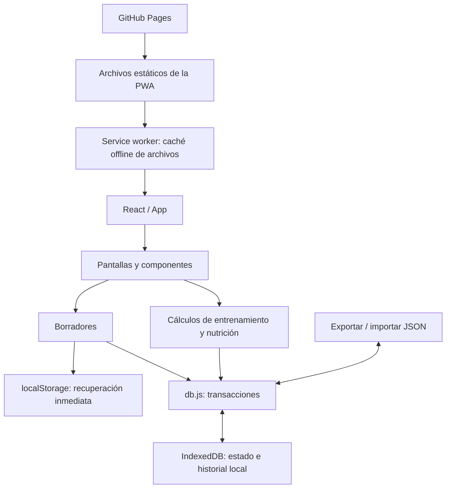

# Arquitectura de BLOOD & GUTS

Revisión del 31 de octubre de 2026, zona America/Santiago. Código base: `3ce7a5c`, rama `templates/inicio`.

El pedido de organizar tres especialistas se concretó como una revisión de arquitectura del proyecto existente. Esta entrega documenta hallazgos y verificaciones; no cambia pantallas, cálculos, dependencias, esquema ni datos del usuario.

## Trabajo paralelo e integración

| Responsable | Tarea independiente | Archivo exclusivo |
| --- | --- | --- |
| Frontend | Composición, navegación, accesibilidad y efectos | [frontend-review.md](frontend-review.md) |
| Backend local | IndexedDB, migraciones, borradores y respaldos | [backend-review.md](backend-review.md) |
| Testing | Pruebas de lógica, compilación y navegador | [testing-review.md](testing-review.md) |
| Arquitecto principal | Contrastar evidencias, resolver discrepancias e integrar | Este índice y enlace en el README principal |

Los especialistas no editaron archivos de aplicación ni hicieron commits. Solo testing ejecutó las pruebas y generó los artefactos temporales, evitando conflictos con compilaciones y servidores. La integración y el commit corresponden al agente principal.

## Componentes y flujo de datos

GitHub Pages distribuye la aplicación; los registros personales permanecen en el navegador. El service worker conserva archivos de la app y no sincroniza IndexedDB entre dispositivos. Un respaldo JSON externo permite trasladar los datos. El término backend de esta revisión se refiere a esa capa local; no se añadió un servidor.

Se mantiene la arquitectura offline existente, las transacciones atómicas, las revisiones y la migración con comprobación de contenidos. No se recomienda una reescritura ni eliminar historial para reducir su tamaño.

## Hallazgos y orden recomendado

P2 indica una mejora importante para una siguiente etapa; P3, mantenimiento y optimización. Ninguno de los hallazgos estáticos demuestra por sí solo un incidente en el teléfono del usuario.

| Prioridad | Hallazgo | Evidencia y siguiente comprobación |
| --- | --- | --- |
| P2 | Exportar no espera expresamente los borradores pendientes | B-01 del informe local. La navegación normal sí espera el guardado; investigar el caso de editar y exportar dentro de Historial. Verificar el JSON y su importación con el reloj controlado. |
| P2 | Cada guardado procesa el historial completo | B-02: lectura y proyección global, con búsqueda repetida de sesiones. Medir con historiales sintéticos antes de separar escrituras; conservar atomicidad y migraciones. |
| P2 | Falta un límite de errores de renderizado | Frontend, hallazgo 1. Probar una excepción controlada y una salida recuperable que conserve IndexedDB. No se reprodujo una caída espontánea. |
| P2 | Navegar no traslada expresamente el foco al contenido | Frontend, hallazgo 2. Verificar teclado y lector de pantalla antes de implementar el enfoque del encabezado. No alterar el foco al registrar series. |
| P3 | Pantallas y estilos concentrados en el arranque | Frontend, hallazgo 3. Medir carga y separar componentes gradualmente; cualquier carga diferida debe seguir disponible offline. |

La primera intervención propuesta es asegurar la coherencia del respaldo con los borradores. Después conviene abordar recuperación de errores y foco, y medir persistencia y carga inicial antes de optimizarlas. Estas son recomendaciones, no correcciones implementadas en esta entrega.

## Verificación de integración

El agente principal contrastó las referencias de los informes con el código: confirmó que el permiso de persistencia se implementa en `src/storage.js`, que el arranque importa dieciséis hojas CSS y que la navegación vacía borradores antes de cambiar de sección. Se corrigieron las citas de los informes antes de integrarlos. El posible problema de exportación se delimitó al caso sin navegación previa, evitando presentar el flujo habitual como defectuoso.

| Comprobación | Resultado |
| --- | --- |
| `npm test` | 137/137 pruebas aprobadas |
| `npm run build` | Correcto; advertencia de fragmento JS de 555,90 kB (169,39 kB gzip) |
| `npm run test:e2e` | 106/106 casos Playwright aprobados en 10,9 minutos |
| Rutas citadas y `git diff --check` | Correctos |

Las pruebas de navegador incluyen migración y reversión, respaldo de ida y vuelta, actualización real de la PWA y recuperación offline, navegación, cardio, registro compacto y modos visuales. La advertencia de tamaño de compilación respalda medir la carga inicial; no demuestra problemas de FPS. La suite no cubre todos los riesgos estáticos de los informes. La comprobación dirigida del borrador pendiente al exportar se registra en el informe de testing.

El intento adicional de reproducir B-01 no llegó a exportar: un problema de codificación del script de instrumentación impidió completar la configuración inicial. No es un fallo de la suite ni evidencia de un defecto de la aplicación. B-01 permanece como riesgo identificado en código, pendiente de una reproducción controlada.

El despliegue de la versión base terminó correctamente en [GitHub Actions](https://github.com/AlvaroVZ14/Templates/actions/runs/39197749332). La aplicación publicada está en [BLOOD & GUTS](https://alvarovz14.github.io/Templates/). Esto no verifica qué versión conserva cada teléfono; esta entrega documental no publica nuevas funciones.

## Límites y trazabilidad

No se accedió a los datos del navegador personal del usuario, ni se midieron FPS o tiempos en un teléfono físico, ni se realizó una auditoría de dependencias o una certificación de seguridad. Las pruebas usan datos ficticios. Los informes no incorporan registros personales, claves ni archivos `.env`.

Uso de IA: Codex coordinó tres subagentes, revisó el código, ejecutó las comprobaciones y redactó los informes. No consta una aprobación humana de esta entrega; se deja para la revisión del Pull Request. Las reglas generales de contribución se respetan sin trasladar a esta app los requisitos del proyecto académico ajeno descrito en el `AGENTS.md` heredado.
